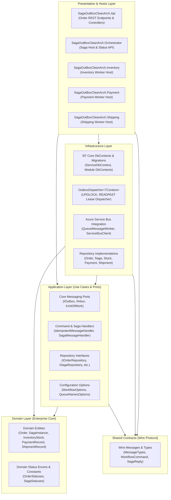
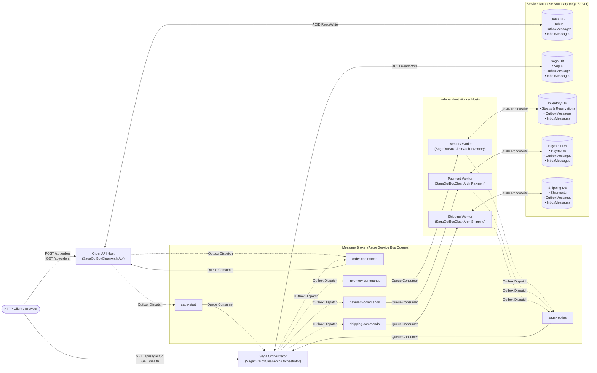
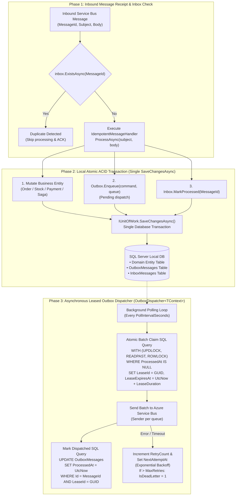
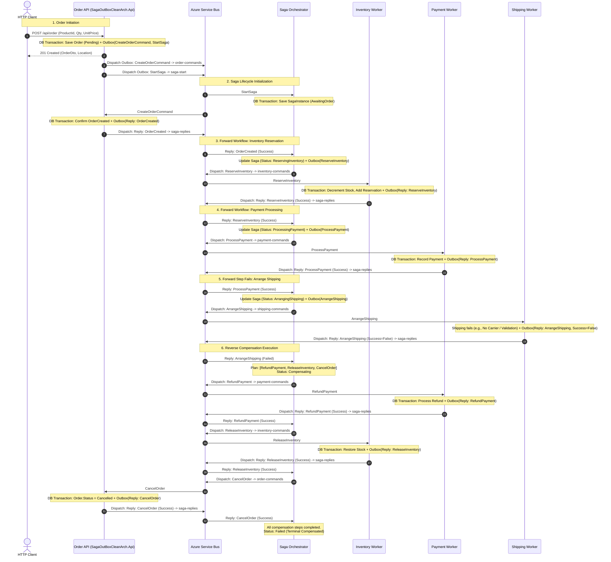
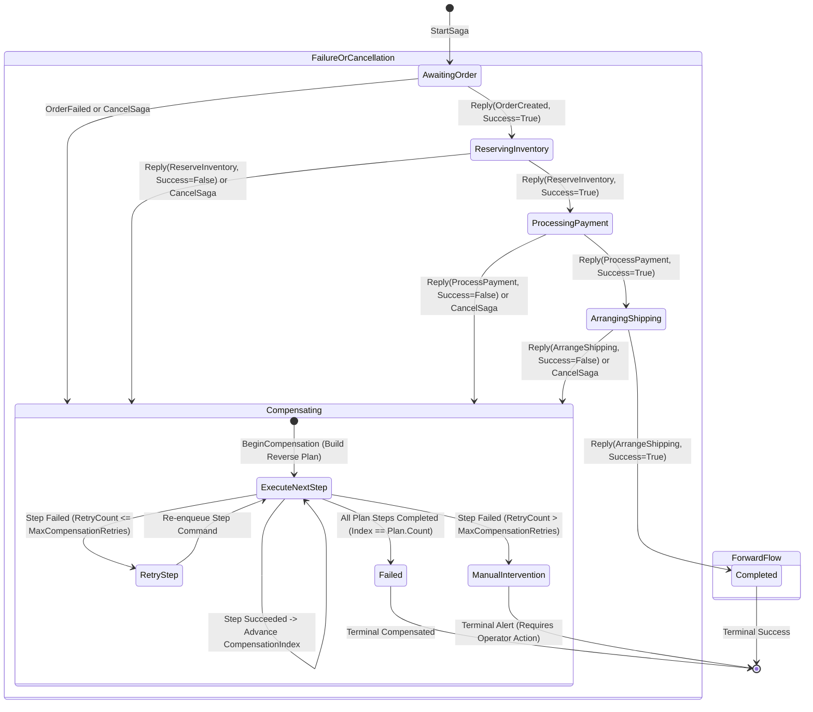

# Saga and Outbox with Clean Architecture

A .NET 10 order workflow built from five independently deployable processes (Order API, Orchestrator,
Inventory, Payment, Shipping), using the **saga** (orchestration) and **transactional outbox / inbox** patterns
over Azure Service Bus and SQL Server. Each service owns its own database and outbox.

---

## Credits

This project was built end-to-end using AI coding assistants—specifically **Deep Seek** (via Web interface), **GitHub Copilot** (via Visual Studio Community Edition) and **Google Antigravity** (via Visual Studio Code Extension).

Not a single line of code was written by a human. All system architecture, development, clean-architecture refactoring, automated tests, and documentation were produced entirely through AI assistants.

Whole effort took around four hours. The process followed is as below:

1. Idea phase -> Interact with **Deep Seek** to establish broader expectations. Once refined get optimized tokens from **Deep Seek**
2. Architecture phase -> Using **GitHub Copilot** to create basic structure and  working model
3. Implementation phase -> Through interactive sessions and chats refine the idea.
4. Final signoff and verify -> Give final touch and refactoring using **Google Antigravity**
5. Documentation phase -> Using **Google Antigravity** create diagrams and documentation

---

## Solution layout

```
src/
  SagaOutBoxCleanArch.Domain          Entities and status constants. No dependencies.
  SagaOutBoxCleanArch.Contracts       Wire contracts shared between services (messages, MessageTypes, status response). No dependencies.
  SagaOutBoxCleanArch.Application     Use cases and message handlers, plus the abstractions they need
                             (repositories, IOutbox / IInbox / IUnitOfWork, options). Depends on Domain + Contracts.
  SagaOutBoxCleanArch.Infrastructure  EF Core DbContexts + migrations, repositories, Service Bus consumer, outbox dispatcher,
                             DI wiring. Depends on Application + Domain.
  SagaOutBoxCleanArch.Api             Order REST API (host)            -> Application, Infrastructure
  SagaOutBoxCleanArch.Orchestrator    Saga orchestrator + status API   -> Application, Infrastructure
  SagaOutBoxCleanArch.Inventory       Inventory worker (host)          -> Application, Infrastructure
  SagaOutBoxCleanArch.Payment         Payment worker (host)            -> Application, Infrastructure
  SagaOutBoxCleanArch.Shipping        Shipping worker (host)           -> Application, Infrastructure
tests/
  SagaOutBoxCleanArch.Tests           Handler/service tests (EF InMemory) and architecture rules
diagrams/
  Standalone Mermaid architectural diagram files (.mmd)
```

Dependencies point inward only: `Hosts -> Infrastructure -> Application -> Domain`. `ArchitectureTests` enforce that
Domain and Contracts reference no other project, and that Application references neither Infrastructure,
EF Core nor Service Bus.

Inside each layer, code is grouped by module (`Orders`, `Sagas`, `Inventory`, `Payments`, `Shipping`) with shared
messaging code in `Messaging`.

### How the pieces fit

- **Handlers** (`Application/<Module>/*CommandHandler`, `SagaMessageHandler`) derive from `IdempotentMessageHandler`,
  which does the inbox check, runs the handler, records the inbox entry and commits once through `IUnitOfWork`.
  Business state, inbox row and outgoing outbox rows therefore commit in one transaction.
- **`ServiceDbContext`** (Infrastructure) is the shared base context. It owns the `OutboxMessages` / `InboxMessages`
  tables and implements `IOutbox`, `IInbox` and `IUnitOfWork`; each service's context derives from it.
- **Each host** calls `Add<Module>Application()` and `Add<Module>Infrastructure(configuration)` in `Program.cs`,
  and nothing else is needed to wire it.
- **Config** is bound to `WorkflowOptions` (`Workflow:*`) and `QueueNamesOptions` (`ServiceBus:*Queue`) instead of
  handlers reading `IConfiguration` directly. Configuration keys are unchanged.
- **Message subjects** are constants in `SagaOutBoxCleanArch.Contracts.MessageTypes`.

---

## Architectural Diagrams

The solution includes five complementary architectural perspectives modeling its static structure, deployment topology, data integrity mechanisms, and distributed workflow. Raw diagram files are maintained in the [`diagrams/`](diagrams/) directory.

### 1. Clean Architecture Dependencies (Onion View)
> Source: [`diagrams/1-clean-architecture-dependencies.mmd`](diagrams/1-clean-architecture-dependencies.mmd)

Enforces the inward dependency rule where business entities and use cases are independent of UI, database, and message broker implementations.



---

### 2. Distributed Container & Queue Topology
> Source: [`diagrams/2-distributed-container-topology.mmd`](diagrams/2-distributed-container-topology.mmd)

Shows independently deployable processes, per-service isolated SQL Server database boundaries, and Azure Service Bus queues.



---

### 3. Transactional Outbox & Idempotent Inbox Pattern
> Source: [`diagrams/3-transactional-outbox-inbox.mmd`](diagrams/3-transactional-outbox-inbox.mmd)

Eliminates the dual-write problem by saving business entity changes, outbox rows, and inbox records within a single ACID transaction, combined with an asynchronous leased dispatcher (`OutboxDispatcher<TContext>`).



---

### 4. Saga Orchestration & Compensation Sequence
> Source: [`diagrams/4-saga-orchestration-sequence.mmd`](diagrams/4-saga-orchestration-sequence.mmd)

Chronological message flow depicting order placement, forward execution across services, and reverse-order compensation upon a step failure.



---

### 5. Saga State Machine Lifecycle
> Source: [`diagrams/5-saga-state-machine.mmd`](diagrams/5-saga-state-machine.mmd)

Models the discrete lifecycle states of `SagaInstance` as defined in `SagaStatuses`.



---

## Run locally

Each service needs `ConnectionStrings:ServiceDatabase` (SQL Server) and Service Bus configuration
(`ServiceBus:Namespace` or `ServiceBus:ConnectionString`; use user-secrets, never commit credentials).
Provision queues `order-commands`, `inventory-commands`, `payment-commands`, `shipping-commands`, `saga-replies`
and `saga-start`.

```powershell
dotnet restore SagaOutboxWithCleanArch.sln
dotnet run --project src/SagaOutBoxCleanArch.Api
dotnet run --project src/SagaOutBoxCleanArch.Orchestrator
dotnet run --project src/SagaOutBoxCleanArch.Inventory
dotnet run --project src/SagaOutBoxCleanArch.Payment
dotnet run --project src/SagaOutBoxCleanArch.Shipping
dotnet test SagaOutboxWithCleanArch.sln
```

Without Service Bus configuration the Order API still works and stores outbox rows; it logs a warning and does not
dispatch them. The other hosts require Service Bus.

## EF Core migrations

All DbContexts live in `SagaOutBoxCleanArch.Infrastructure`, with migrations under
`Persistence/<Module>/Migrations`. Use the Infrastructure project as the migrations project and the owning host
as the startup project (each host registers only its own context):

```powershell
dotnet ef migrations add <Name> --project src/SagaOutBoxCleanArch.Infrastructure --startup-project src/SagaOutBoxCleanArch.Api          --context OrderDbContext     --output-dir Persistence/Orders/Migrations
dotnet ef migrations add <Name> --project src/SagaOutBoxCleanArch.Infrastructure --startup-project src/SagaOutBoxCleanArch.Orchestrator --context SagaDbContext      --output-dir Persistence/Sagas/Migrations
dotnet ef migrations add <Name> --project src/SagaOutBoxCleanArch.Infrastructure --startup-project src/SagaOutBoxCleanArch.Inventory     --context InventoryDbContext --output-dir Persistence/Inventory/Migrations
dotnet ef migrations add <Name> --project src/SagaOutBoxCleanArch.Infrastructure --startup-project src/SagaOutBoxCleanArch.Payment       --context PaymentDbContext   --output-dir Persistence/Payments/Migrations
dotnet ef migrations add <Name> --project src/SagaOutBoxCleanArch.Infrastructure --startup-project src/SagaOutBoxCleanArch.Shipping      --context ShippingDbContext  --output-dir Persistence/Shipping/Migrations
dotnet ef database update      --project src/SagaOutBoxCleanArch.Infrastructure --startup-project src/SagaOutBoxCleanArch.Api          --context OrderDbContext
```

## API & HTTP Endpoints

The solution exposes HTTP endpoints across two independent web processes. Each project includes a pre-configured `.http` file for testing directly in your IDE (Visual Studio, VS Code REST Client, JetBrains Rider).

### 1. Order REST API (`SagaOutBoxCleanArch.Api`)
- **Default Port**: `http://localhost:5249` (HTTPS: `https://localhost:7032`)
- **HTTP Client File**: [`src/SagaOutBoxCleanArch.Api/SagaOutBoxCleanArch.Api.http`](src/SagaOutBoxCleanArch.Api/SagaOutBoxCleanArch.Api.http)

| Method | Endpoint | Description |
|:---|:---|:---|
| `POST` | `/api/order` | Create a new order; atomically writes `Order` (Pending), `CreateOrderCommand`, and `StartSaga` outbox rows. |
| `GET` | `/api/order` | Retrieve the 100 most recent orders. |
| `GET` | `/api/order/{id}` | Retrieve a specific order by its unique GUID. |
| `POST` | `/api/order/{id}/cancel` | Cancel an order and stage a `CancelSaga` message to initiate reverse compensation. |
| `GET` | `/health` | Health check probe (returns `{"status":"healthy"}`). |

### 2. Saga Orchestrator (`SagaOutBoxCleanArch.Orchestrator`)
- **Default Port**: `http://localhost:5250` (HTTPS: `https://localhost:7033`)
- **HTTP Client File**: [`src/SagaOutBoxCleanArch.Orchestrator/SagaOutBoxCleanArch.Orchestrator.http`](src/SagaOutBoxCleanArch.Orchestrator/SagaOutBoxCleanArch.Orchestrator.http)

| Method | Endpoint | Description |
|:---|:---|:---|
| `GET` | `/api/sagas/{id}` | Query the real-time saga instance state, current status (`AwaitingOrder`, `Completed`, `Compensating`, etc.), and completed steps. |
| `GET` | `/health` | Health check probe (returns `{"status":"healthy"}`). |

## Workflow behaviour

Order created → reserve inventory → process payment → arrange shipping. A failed step triggers reverse-order
compensation (cancel shipping, refund, release inventory, cancel order, as applicable); repeated compensation
failure moves the saga to `ManualIntervention`. Delivery is at-least-once: handlers are idempotent through the
inbox table and saga state ignores stale or duplicate replies. The outbox dispatcher claims rows with
`UPDLOCK, READPAST` and a lease, so multiple replicas are safe.

Simulation switches: `Workflow:DefaultAvailableQuantity`, `Workflow:DeclinedProductPrefix` (default `DECLINE-`),
`Workflow:ShippingFailureProductPrefix`, `Workflow:MaxCompensationRetries`.
